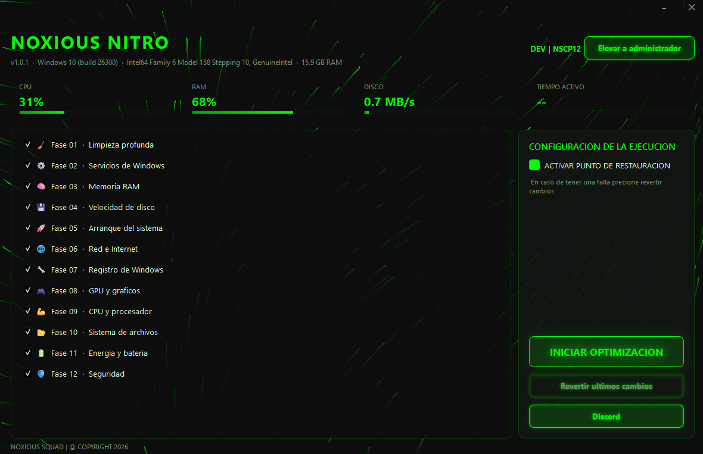

<p align="center">
  
</p>

<h1 align="center">NOXIOUS NITRO</h1>

<p align="center">
  Optimizador de Windows en 12 fases · Reversible · Portable · Sin telemetría
</p>

<p align="center">
  
  
  
  
  
</p>

---

**NOXIOUS NITRO** es una aplicación de escritorio para Windows que aplica optimizaciones al sistema en **12 fases independientes**. Cada fase toca un área concreta (limpieza, servicios, memoria, red, registro, GPU, energía...) y **registra cada cambio** para poder deshacerlo después con un solo botón.

No instala servicios, no deja procesos en segundo plano y no envía datos a ningún servidor: es un ejecutable único que se abre, optimiza y se cierra.

---

## ¿Cómo funciona?

### 1. Selección de fases

Al abrir la aplicación se muestran las 12 fases con una casilla cada una. Todas vienen marcadas por defecto, pero puedes desmarcar las que no quieras aplicar. La ejecución es **secuencial** y cada fase es autónoma: si una falla, las demás continúan y el error queda registrado en el log.

| # | Fase | Qué hace |
|---|------|----------|
| 01 | 🧹 Limpieza profunda | Temporales, cachés, papelera, prefetch antiguo y volcados de memoria |
| 02 | ⚙️ Servicios de Windows | Deshabilita servicios prescindibles (telemetría, Xbox, etc.) |
| 03 | 💾 Memoria RAM | Recorta *working sets* y libera memoria inactiva |
| 04 | 💿 Velocidad de disco | TRIM en SSD, desfragmentación en HDD e informe SMART |
| 05 | 🚀 Arranque del sistema | Inicio rápido y limpieza de programas de arranque |
| 06 | 🌐 Red e Internet | DNS rápidos, limpieza de caché y ajuste de parámetros TCP |
| 07 | 🔧 Registro de Windows | Elimina restos de programas desinstalados (modo conservador) |
| 08 | 🎮 GPU y gráficos | Informe de drivers y aceleración por hardware (HAGS) |
| 09 | 🔥 CPU y procesador | Plan de máximo rendimiento y CPU sin estrangulamiento |
| 10 | 📁 Sistema de archivos | Ajustes NTFS: último acceso desactivado, estado de nombres 8.3 |
| 11 | 🔋 Energía y batería | Informe de salud de la batería y ahorro inteligente |
| 12 | 🛡️ Seguridad | Defender, firewall y UAC verificados y reforzados |

### 2. Punto de restauración

Antes de tocar nada, la app puede crear un **punto de restauración de Windows** (opción activada por defecto). Si algo sale mal, puedes volver atrás desde el propio panel de Windows, incluso si la aplicación ya no está.

### 3. Backup interno y reversión

Además del punto de restauración, el motor guarda un **backup en JSON** con el estado previo de cada elemento modificado: valor anterior de cada clave de registro, estado de inicio de cada servicio, configuración de energía, DNS, etc.

- Ubicación: `%LOCALAPPDATA%\NOXIOUS NITRO\backups\backup_AAAAMMDD_HHMMSS.json`
- El botón **Revertir últimos cambios** lee el backup más reciente y restaura los valores originales uno por uno.

### 4. Ejecución y registro

La optimización corre en un **hilo aparte** (`QThread`), así que la interfaz nunca se congela: la barra de progreso avanza fase por fase y el log muestra en tiempo real qué se cambió, qué se omitió y qué falló, con colores por nivel (`info`, `ok`, `warn`, `err`).

- Log en pantalla + archivo: `%LOCALAPPDATA%\NOXIOUS NITRO\logs\nitro_AAAAMMDD_HHMMSS.log`
- Botón **Cancelar** para detener la ejecución entre pasos.

### 5. Privilegios

Windows no permite modificar servicios, registro o energía sin permisos elevados. Si la app no se abrió como administrador, muestra un botón **Elevar a administrador** que relanza el proceso con UAC y reabre la ventana. El título de la ventana indica `[ADMIN]` cuando ya tiene privilegios.

### Ejecutar desde el código

```bash
# 1. Clonar
git clone https://github.com/NOXIOUS-SQUAD/NOXIOUS-NITRO
cd noxious-nitro

# 2. Entorno virtual
python -m venv .venv
.venv\Scripts\activate

# 3. Dependencias
pip install -r requirements.txt

# 4. Ejecutar
python launcher.py
```

O simplemente doble clic en `run.bat` (crea el entorno si no existe).

### Compilar el ejecutable

```bash
pyinstaller --noconfirm --clean --onefile --windowed ^
  --name "NOXIOUS NITRO" --icon ico.ico ^
  --add-data "ico.ico;." --version-file version_info.txt launcher.py
```

El resultado queda en `dist\NOXIOUS NITRO.exe`: un único archivo portable de ~46 MB, sin instalador.

---

## Estructura del proyecto

```
NOXIOUS NITRO/
│
├── launcher.py               # Punto de entrada (solo llama a app.main)
├── requirements.txt          # PySide6, psutil, pywin32
├── version_info.txt          # Metadatos del .exe (versión, compañía, descripción)
├── NOXIOUS NITRO.spec        # Receta de PyInstaller
├── ico.ico                   # Icono de la aplicación
├── img.png                   # Captura usada en este README
├── run.bat                   # Ejecutar en modo desarrollo
├── 1.bat                     # Crear entorno + compilar el .exe
│
└── app/
    ├── main.py               # Arranque: QApplication, estilos, icono, ventana
    ├── config.py             # Nombre, versión, colores, rutas (LOCALAPPDATA)
    │
    ├── core/                 # Lógica sin interfaz
    │   ├── admin.py          # Detección de admin y relanzado con UAC
    │   ├── backup.py         # BackupManager: registra y restaura cambios
    │   ├── restore.py        # Creación del punto de restauración de Windows
    │   ├── logger.py         # Logger a archivo con marca de tiempo
    │   ├── proc.py           # Envoltorios de subprocess / PowerShell
    │   └── sysinfo.py        # CPU, RAM, disco y tiempo activo en vivo
    │
    ├── phases/               # Una fase = un archivo
    │   ├── __init__.py       # Lista PHASES (orden de ejecución)
    │   ├── base.py           # Phase + PhaseContext (log, backup, dry_run)
    │   ├── p01_cleanup.py
    │   ├── p02_services.py
    │   ├── p03_memory.py
    │   ├── p04_disk.py
    │   ├── p05_boot.py
    │   ├── p06_network.py
    │   ├── p07_registry.py
    │   ├── p08_gpu.py
    │   ├── p09_cpu.py
    │   ├── p10_filesystem.py
    │   ├── p11_power.py
    │   └── p12_security.py
    │
    └── ui/                   # Interfaz (PySide6)
        ├── main_window.py    # Ventana sin bordes, barra de título y páginas
        ├── particles.py      # Fondo animado de partículas
        ├── styles.py         # Hoja de estilos QSS (tema verde neón)
        ├── widgets.py        # GlowButton y StatCard
        └── worker.py         # OptimizeWorker (QThread) que ejecuta las fases
```

### Cómo añadir una fase

1. Crea `app/phases/p13_mi_fase.py` heredando de `Phase`.
2. Define `id`, `name`, `icon`, `description` y el método `run()`.
3. Usa `self.ctx.log()` para informar y `self.ctx.backup.record(...)` antes de cambiar algo.
4. Añádela a la lista `PHASES` en `app/phases/__init__.py`.

La interfaz la detecta automáticamente: no hay que tocar nada más.

---

## Ventajas

- **Reversible de verdad.** Doble red de seguridad: punto de restauración de Windows + backup JSON propio con el valor anterior de cada cambio. El botón de reversión restaura servicios, registro, DNS y energía exactamente como estaban.
- **12 fases seleccionables.** No es un "todo o nada": aplicas solo lo que necesitas y repites la operación las veces que quieras.
- **Portable y sin instalación.** Un solo `.exe` de ~46 MB. No instala servicios, no añade entradas de arranque, no deja residuos en `Program Files`.
- **Cero telemetría.** No requiere internet ni envía datos. Todo se queda en tu equipo: backups y logs en `%LOCALAPPDATA%\NOXIOUS NITRO`.
- **Interfaz que no se congela.** El trabajo pesado corre en un hilo separado con progreso por fase y log en vivo, además de cancelación limpia.
- **Transparencia total.** Cada acción se registra con su resultado (aplicado / omitido / error) en pantalla y en un archivo de log revisable después.
- **Modo simulación.** El motor soporta `dry_run`: recorre todas las fases y reporta lo que haría sin cambiar nada en el sistema.
- **Arquitectura modular.** Core, fases e interfaz separados. Añadir o quitar una optimización es crear o borrar un archivo de ~50 líneas.
- **Elevación integrada.** Detecta si faltan privilegios y ofrece relanzarse como administrador sin cerrar la app a mano.
- **Conservador donde importa.** El registro se limpia solo con restos verificables de programas ya desinstalados, y las fases de seguridad *verifican y refuerzan*, no desactivan protecciones.

---

## Requisitos

- Windows 10 / 11 (64 bits)
- Python 3.11+ (solo para ejecutar desde el código)
- Permisos de administrador para aplicar los cambios

---

<p align="center">
  <b>¿Dudas, soporte o novedades?</b><br><br>
  <a href="https://discord.gg/CE8xPnpV6a">
    
  </a>
  <br><br>
  <a href="https://discord.gg/CE8xPnpV6a">https://discord.gg/CE8xPnpV6a</a>
</p>

<p align="center">
  <sub>NOXIOUS SQUAD · © 2026</sub>
</p>
